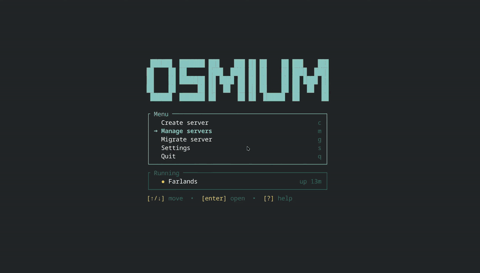

<div align="center">


Create servers, run them, install mods, watch their consoles - from one terminal, or from a script.

**[Documentation and guides -> osmiummc.com](https://osmiummc.com)**

[](https://go.dev)
[](LICENSE)
[](https://github.com/limelamp/osmium/releases)
[](https://osmiummc.com)



</div>

---

## What it is

Osmium aids in the creation and the managing of Minecraft servers, all done from the terminal. It downloads the server software, keeps track of where each server lives and what/how it runs, and gives every server a console you can see and type into.

Mods and plugins are managed the way a package manager manages packages: dependencies are resolved, the whole change is shown before it happens, downloads are verified and shared between servers, and a manifest and lock file describe a server exactly enough to rebuild it somewhere else.

Everything the interface does, a command does too. `osmium` opens the full-screen interface; 
`osmium start -s survival` starts a server from a script.

## Screenshots

The home page lists what is running:


Manage Servers puts the list, the actions and the server's console on one screen:


The create wizard walks through the choices, one at a time:


## Requirements

- **Java** - whatever your server software needs (Java 21 for Minecraft 1.20.5 and newer, lookup the rest yourself).
- A terminal with UTF-8 and 256 colours. Minimum size is **60 × 18**.
- If building, use **Go 1.25+**.

## Installing

Linux and macOS:

```bash
curl -fsSL https://osmiummc.com/install.sh | sh
```

Windows (PowerShell):

```powershell
irm https://osmiummc.com/install.ps1 | iex
```

The scripts download the latest release, verify its checksum and install it into your user directory, no `sudo` needed. [`install.sh`](install.sh) and [`install.ps1`](install.ps1) are in this repo if you want to read them first.

Or with Go 1.25+:

```bash
go install github.com/limelamp/osmium@latest
```

Or build from source:

```bash
git clone https://github.com/limelamp/osmium.git
cd osmium
make build           # ./bin/osmium
make install         # into $(go env GOPATH)/bin
```

Or take a binary from the [releases](https://github.com/limelamp/osmium/releases) - Linux, macOS and
Windows, amd64 and arm64.

Then to set up tab completion, run the command below once:

```bash
osmium completion install
```

It completes server names, your installed mods and plugins, engines and Minecraft versions.

## Quick start

```bash
osmium                                   # the interface
osmium create                            # a wizard, or give it flags:
osmium create --name survival --engine Paper --version 1.21.1 --ram 4G --eula

osmium start   -s survival               # start it; it keeps running when you close Osmium
osmium logs    -s survival -f            # watch it
osmium exec    -s survival say hello     # talk to it
osmium mod add sodium -s survival        # install a mod, and whatever it needs
osmium stop    -s survival               # ask it to shut down and save

osmium install ./skyblock/osmium.json    # build a whole server from a recipe
osmium install cobblemon.mrpack          # or from a Modrinth modpack
```

`--server`/`-s` names a registered server. Leave it out and the command acts on the folder you are
standing in, so you can `cd` into a server and type `osmium logs -f`.

Running `osmium -s survival` opens the interface straight onto that server. Running it inside a
server folder does the same.

## Commands

**The server itself**

| Command | What it does |
|---|---|
| `osmium` | Open the interface (tui). `-s <name>` opens it on one server |
| `osmium create` | Create a server - a wizard, or fully specified by flags |
| `osmium list` | Every registered server, what it runs, and whether it is up |
| `osmium details` | One server in full: engine, disk, players, ops, bans, mods |
| `osmium start` / `stop` / `restart` | Run it, ask it to shut down, or both |
| `osmium exec <command…>` | Send a console command to a running server |
| `osmium logs [-f] [-n 200]` | Read or follow a server's output |
| `osmium edit --name … --ram …` | Change what Osmium keeps: the name and the memory |
| `osmium migrate [-l Paper] [-v 1.21.1]` | Move a server to another loader or version |
| `osmium destroy` | Delete a server, after typing its name |
| `osmium install [recipe]` | Build a whole server from a manifest, a lock or a `.mrpack` |
| `osmium doctor` | Check Java, memory, the port, the licence and the files |
| `osmium backup [label]` / `osmium restore` | Copy the world and settings, and put them back |
| `osmium expose [--check] [--open]` | Say how to reach a server; have the router open its port |

**Mods and plugins**

Osmium manages these the way a package manager does. Every command works the
whole change out first — including anything a mod needs — shows it, and applies
it in one go. Nothing is written until every file has arrived and been checked
against the hash Modrinth publishes, so a failure halfway leaves the server as
it was. Files are kept in a shared cache by their content, so the same mod
wanted twice is downloaded once.

| Command | What it does |
|---|---|
| `osmium mod add <name…>` | Install it and whatever it needs. `name@build` holds it at one build |
| `osmium mod remove <name…>` | Remove it, and anything left that nothing needs |
| `osmium mod list` | What is installed, which build, and why it is there |
| `osmium mod install` | Install exactly what the manifest and lock describe |
| `osmium mod update [name…]` | Move to the newest builds, leaving pinned ones alone |
| `osmium mod pin <name>` / `unpin` | Hold a mod where it is, or let it move again |
| `osmium mod versions <name>` | The builds this server could install |
| `osmium mod search <words>` | Find mods that fit this server |
| `osmium mod track` | Adopt jars already sitting in `mods/` |
| `osmium cache` / `osmium cache clean` | Where the downloads are kept, and how much room they take |

`osmium plugin …` is the same, for `plugins/`.

**Two files describe a server**

`osmium.json` is what you asked for — the mods you named, and any you pinned.
`osmium.lock` is what that resolved to: exact builds, hashes and which mod
pulled in which. Hand someone both and `osmium install` gives them the same
server, file for file. Hand them just the manifest and it resolves afresh.

```json
osmium.json                          osmium.lock
{                                    spectrum    1.10.5   asked for
 "mods": {                           fabric-api  0.102.0  needed by spectrum
  "spectrum": "*",                   owo-lib     0.12.6   needed by spectrum
  "sodium": "0.5.8"                  sodium      0.5.8    pinned
 }
}
```

Jars Osmium did not install are never touched. Every plan names them, and
`osmium mod track` adopts them when you want them managed.

Every command takes `-s/--server`. `osmium <command> --help` has the details.

The full reference, with a worked example for every command, is at
[osmiummc.com/docs/cli/reference](https://osmiummc.com/docs/cli/reference).

## Controls

| Key | Where | What |
|---|---|---|
| `↑ ↓` `j k` | anywhere | Move; lists wrap around at the ends |
| `enter` | anywhere | Choose, or open a field for typing |
| `esc` | anywhere | Cancel what you are typing, else go back |
| `tab` | Manage Servers, Settings | Move between panes |
| `alt+1` `alt+2` `alt+3` | Manage Servers | Hide and show the servers, actions and console |
| `ctrl+l` | Manage Servers | The next of the three layouts |
| `enter` | Servers pane | Open that server's actions |
| `/` | any list | Filter it; `esc` clears |
| `ctrl+u` | any field | Clear it |
| `↑ ↓` | Activity | Walk back through what you have typed |
| `tab` | Activity | Complete a saved command's name into the command |
| `end` | Activity | Jump to the newest line and resume following |
| `space` `ctrl+a` | file and mod lists | Mark one, mark all |
| `?` | anywhere | The keys that work right here |
| `q` `ctrl+c` | home / anywhere | Quit |

The mouse works too: click to focus a pane, click a row to select it, click again to open it, and the wheel scrolls whatever is under the pointer.

## Development

```bash
make            # list the targets
make run        # go run .
make test       # go test ./...
make lint       # golangci-lint, configured in .golangci.yml
make fmt        # gofumpt + goimports
make snapshot   # build the release artefacts locally
```

The layout:

```
cmd/                the command line, one file per command
internal/build/     what the binary knows about itself
internal/config/    config.json and osmium.json
internal/scope/     where an operation runs, and where its output goes
internal/shared/    Modrinth, migration, player records
internal/supervisor/the detached process that owns a running server
internal/util/      downloading and installing server software
internal/tui/       the interface
    core/           layout, lists, scrolling, messages, fields, tickers
    styles/         containers, rows, hints, logs, progress bars
    components/     the panels
    pages/          the screens
```

Pull requests are welcome. `make lint test` should pass before you open one.

## License

Osmium is free software under the [GNU General Public License v3.0](LICENSE).

Copyright © 2026 **Limelamp**.

Third-party names, marks and work are credited in [NOTICE](NOTICE) — the server
software Osmium installs, the Modrinth API it fetches from, the themes it is
named after, and the libraries it is built with.

## Not an official Minecraft product

Osmium is not an official Minecraft product. It is not approved by or
associated with Mojang or Microsoft. Minecraft is a trademark of Mojang
Synergies AB.

Osmium bundles no Minecraft file: it downloads the server software you ask for
from the publisher's own endpoint, and writes `eula.txt` only once you have
accepted [Mojang's EULA](https://aka.ms/MinecraftEULA) yourself, with `--eula`
or the wizard's Agreements step.
